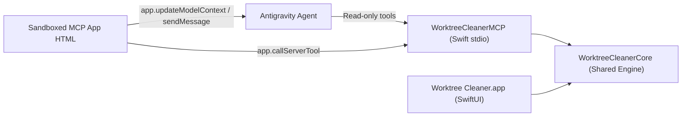

<div align="center">

# Worktree Cleaner

**A native macOS Liquid Glass inspector & safe cleaner for Git worktrees left behind by AI coding agents.**

*See what each worktree actually built, commit & push unfinished changes in one click, slim down `node_modules`, and move stale directories to Trash — without risking lost work.*

<p>
  <a href="https://github.com/isdou/WorktreeCleaner/releases"></a>
  
  
  
  <a href="LICENSE"></a>
</p>

[简体中文](README_ZH.md) · [Download Release](https://github.com/isdou/WorktreeCleaner/releases) · [Report Bug](https://github.com/isdou/WorktreeCleaner/issues/new/choose) · [Discussions](https://github.com/isdou/WorktreeCleaner/discussions)

</div>

---

## Why Worktree Cleaner?

AI coding agents (**Codex**, **Claude Code**, **Cursor**, **Trae**) spin up isolated Git worktrees under hidden directories like `~/.codex/worktrees` or `.claude/worktrees`. After a few days of parallel coding:

- Dozens of mystery branches pile up and silently eat **10–50+ GB** of SSD space.
- `git worktree list` misses orphaned leftover folders whose `.git` metadata or main repo is gone.
- You hesitate to run `git worktree remove` because you forgot **what that worktree actually built**, whether it holds **uncommitted `.env` / code changes**, or if a dev server or agent is **still running inside it**.

**Worktree Cleaner** turns cleanup into a calm, native macOS workflow: **Recall Context → Inspect Risk → Slim / Push / Backup → Move to Trash**.

---

## Safety Classification & Guardrails

Every discovered worktree or orphan directory is classified automatically into four clear states:

| Level | Meaning | Default Action |
| --- | --- | --- |
| 🟢 **Safe** | Clean tree and merged into default branch (including Squash/Rebase merges via `git cherry` or merged GitHub PR), outside cooldown window | Eligible for **Select All Safe** |
| 🟠 **Review** | Clean tree not yet merged, active within freshness window (default 24h), or unpushed commits present | Manual review before removal |
| 🔴 **Active / Dirty** | Uncommitted modifications, untracked files, or live process holding `cwd` (`lsof`) | Requires explicit review; supports one-click **Commit & Push** or **Auto-Commit Backup** |
| ⚪ **Ghost** | Stale Git worktree metadata whose physical folder no longer exists | One-click `git worktree prune` |

### 4-Layer Safety Guardrails

1. **Active Process Lock (`lsof`)**: Detects live processes whose `cwd` sits inside the worktree and blocks accidental removal unless explicitly overridden.
2. **Freshness Cooldown Guard**: Recently active directories (configurable, default `24h`) are excluded from bulk "Select Safe" cleanup.
3. **Precious Ignored Files Alert**: Scans `git status --ignored=matching` for `.env*`, `secrets.json`, `*.pem`, `*.sqlite`, etc., with one-click **Copy to Main Repo** (non-overwriting).
4. **Trash-First Undo**: Moves removed directories to macOS Trash and prunes Git metadata (`git worktree prune`) rather than irreversible `rm -rf`.

---

## Key Features

- **Automatic Discovery & Orphan Reconciliation**
  - Scans common developer roots (`~/Projects`, `~/Developer`, `~/Code`, `~/Workspace`, `~/src`, `~/Desktop`, `~/Downloads`, up to 2 levels deep) plus `~/.codex/worktrees`, `~/.claude/worktrees`, `~/.cursor/worktrees`, `~/.trae-cn/worktrees`, and `<repo>/.claude/worktrees` / `.worktrees`.
  - Finds **broken git worktrees** (main repo deleted) and **`.git`-less leftover directories** invisible to standard Git CLI.
- **"What Changed" Context Recall**
  - Reads **Codex** (`~/.codex/state_5.sqlite`, read-only) and **Claude Code** (`~/.claude/projects/*.jsonl`) session titles/prompts so you immediately know what the agent was working on.
  - Shows base-branch diff summary, touched modules, commit history, **Squash/Rebase equivalence** (`git cherry`), and **GitHub PR status** (via `gh`).
- **Flexible Workflows**
  - **Slim Build Caches Only**: Moves `node_modules`, `.next`, `.build`, `target`, `DerivedData`, `.venv`, etc. to macOS Trash while keeping 100% of source files and uncommitted edits intact.
  - **One-Click Commit & Push**: Stages, commits with an auto-generated task summary, pushes (including creating a branch from Detached HEAD), and optionally trashes the worktree right after.
  - **Optional Branch Cleanup**: Clean up matching synced local branches while permanently protecting `main` / `master` / `develop` / `dev` / `prd` / `production` / `staging`.
- **Native macOS Experience**
  - Menu bar overview popover + dual-pane Liquid Glass inspector (`⌘K` search, `⌘R` rescan, `↑`/`↓` navigation, Quick IDE launcher for Cursor / VS Code / Zed / Antigravity / Xcode, live EN/ZH toggle, Launch at Login).

---

## Installation

### Download Release (macOS 14+ · Universal Apple Silicon & Intel)

1. Download **`WorktreeCleaner.dmg`** (or **`WorktreeCleaner-macOS.zip`**) from [**GitHub Releases**](https://github.com/isdou/WorktreeCleaner/releases).
2. Open the DMG and drag **Worktree Cleaner** into `/Applications`.
3. Built with a **Developer ID Application** signature, Hardened Runtime, and Apple Notarization for Gatekeeper compatibility.

### Build from Source

Requires macOS 14+, Xcode 16+ / Swift 6.0+:

```bash
git clone https://github.com/isdou/WorktreeCleaner.git
cd WorktreeCleaner
swift test
./scripts/build_app.sh --universal --dmg
open dist/WorktreeCleaner.app
```

---

## Antigravity MCP App (SEP-1865)

Worktree Cleaner includes a **native Antigravity MCP App plugin** built directly on top of `WorktreeCleanerCore` with a single-file sandboxed UI (`@modelcontextprotocol/ext-apps`) — zero Python/Node runtime required at execution time.



### 3 UI Surfaces & Model Safety Isolation

- **Inline Chat Card (`show_worktrees_inline`)**: Renders directly inside a conversation with multi-select checkboxes, disk totals, per-item inspect view, and batch Trash confirmation.
- **Side Pane (`aux_pane`) & Global Page (`global`) via `open_worktree_cleaner`**: Full dual-pane visual workbench accessible from Antigravity's `+` menu or left sidebar.
- **Tool Visibility Isolation (`_meta.ui.visibility: ["app"]`)**: All destructive and mutation tools (`remove_worktree`, `prune_missing_worktrees`, `slim_worktree_caches`, `push_worktree`, `copy_precious_files`, `open_in_finder`) are strictly hidden from the LLM — only direct user clicks in the UI can invoke them, while **Attach to Chat** (`app.updateModelContext`) lets you attach uncommitted worktree details to your prompt for review first.

### Install the Plugin into Antigravity

Requires Node.js 18+ (only for bundling the UI HTML during installation):

```bash
./scripts/install_antigravity_plugin.sh
```

This builds `WorktreeCleanerMCP` (release), bundles the single-file UI, and installs everything into `~/.gemini/config/plugins/worktree-cleaner/` (auto-discovered by Antigravity without restart).

---

## Contributing & Security

- Contributions are welcome! See [CONTRIBUTING.md](CONTRIBUTING.md) for development setup and PR guidelines.
- Found a safety edge case or vulnerability? Please read [SECURITY.md](SECURITY.md) before opening a public issue.
- Questions or workflow ideas? Join [GitHub Discussions](https://github.com/isdou/WorktreeCleaner/discussions).

## License

[MIT License](LICENSE)
