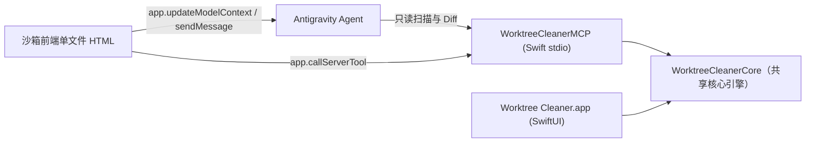

<div align="center">

# Worktree Cleaner

**专为 AI 编程时代打造的 macOS 原生 Liquid Glass Git Worktree 体检与安全清理工具**

*一眼看清每个 Worktree 到底做了什么，一键提交推送、只清 `node_modules` 瘦身、移入废纸篓防误删。*

<p>
  <a href="https://github.com/isdou/WorktreeCleaner/releases"></a>
  
  
  
  <a href="LICENSE"></a>
</p>

[English](README.md) · [下载安装包](https://github.com/isdou/WorktreeCleaner/releases) · [反馈 Bug](https://github.com/isdou/WorktreeCleaner/issues/new/choose) · [参与讨论 Discussions](https://github.com/isdou/WorktreeCleaner/discussions)

</div>

---

## 为什么做 Worktree Cleaner？

在使用 **Codex**、**Claude Code**、**Cursor**、**Trae** 并行开发几天后，电脑里往往会悄悄攒出几十个 `~/.codex/worktrees`、`.claude/worktrees`：

- 动辄吞掉 **10–50+ GB** 磁盘空间；
- 主仓库删除或中断任务留下的残骸目录，连 `git worktree list` 都扫不出来；
- 命令行里根本记不清 **这个 worktree 到底做过什么功能**、有没有藏着未备份的 `.env.local`、或者后台还有没有开发服务器正在运行，结果完全不敢删。

**Worktree Cleaner** 把清理流程做成了一套克制纯粹的 macOS 原生工作流：**唤醒上下文 → 体检评估 → 瘦身/推送/备份 → 移入废纸篓**。

---

## 四级风险分级与安全护栏

工具会对每个 Worktree 或孤儿残留目录自动做多维度体检并归类：

| 状态 | 判定依据 | 默认策略 |
| --- | --- | --- |
| 🟢 **安全可删** | 工作区干净且已合并回主分支（支持 `git cherry` Squash/Rebase 合并识别或已合并 PR），且已过冷却期 | 可纳入「全选安全项」 |
| 🟠 **待确认** | 干净但尚未合并、处于近期活跃冷却期（默认 24 小时），或存在未推送提交 | 需人工看一眼后再决定 |
| 🔴 **有改动 / 运行中** | 存在未提交改动/未跟踪文件，或有活跃进程 `cwd` 落在该目录内 | 建议先审查、一键 **提交并推送** 或移除前 **自动 Commit 备份** |
| ⚪ **幽灵记录** | Git 仍记录该 worktree 元数据，但物理目录已不存在 | 支持一键 `git worktree prune` |

### 四重防误删安全护栏

1. **运行中进程锁（`lsof`）**：自动检测工作目录内仍在运行的开发服务/Agent 进程并标红阻止误删。
2. **新鲜度冷却保护**：默认 24 小时内活跃过的目录自动标记为「近期」，跳过批量清理全选。
3. **敏感忽略孤本预警**：扫描 `.gitignore` 隐藏的 `.env*`、`secrets.json`、`*.pem`、`*.sqlite` 等本地重要文件，支持一键 **拷回主仓库**（跳过已存在文件，绝不覆盖）。
4. **移入废纸篓后悔药**：默认移入 macOS 废纸篓并执行 `git worktree prune`，而非不可逆的 `rm -rf`。

---

## 核心功能

- **全盘发现 + 孤儿目录物理对账**
  - 自动扫描常见代码根目录（`~/Projects`、`~/Developer`、`~/Code`、`~/Workspace`、`~/src`、`~/Desktop`、`~/Downloads`，支持 2 层子目录）以及 `~/.codex/worktrees`、`~/.claude/worktrees`、`~/.cursor/worktrees`、`~/.trae-cn/worktrees`、`<repo>/.claude/worktrees` / `.worktrees`。
  - 主动揪出主仓库已删的 **断根目录** 和无 `.git` 的 **空壳残骸**。
- **记忆唤醒：一眼看清「做了什么」**
  - 只读读取 **Codex**（`~/.codex/state_5.sqlite`）与 **Claude Code**（`~/.claude/projects/*.jsonl`）的原始任务标题与首句指令。
  - 对比默认主分支展示：提交数、影响模块、增删行数、**`git cherry` 等价合并识别**，并可选联动本机 `gh` 显示 **GitHub PR 状态**。
- **灵活处置闭环**
  - **仅瘦身清缓存**：只将 `node_modules`、`.next`、`.build`、`target`、`DerivedData`、`.venv` 移入废纸篓，完整保留全部源码和未提交改动。
  - **一键提交并推送**：自动预填任务 Commit 说明（支持 Detached HEAD 新建分支），推完可顺手移入废纸篓。
  - **可选清理分支**：移除 Worktree 时可分别勾选删除对应的本地分支和 `origin` 分支，两项默认关闭。确认窗口会显示具体的远端分支名。如果远端分支在扫描后收到新提交，清理会停止，保留本地 Worktree。远端删除无法通过 Mac 废纸篓撤销。远端默认分支及 `main`、`master`、`develop`、`dev`、`prd`、`production`、`staging` 等保护分支不参与远端清理。
- **正宗 macOS 原生体验**
  - 顶部菜单栏悬浮概览 + 双栏 Liquid Glass 主窗口（支持 `⌘K` 搜索、`⌘R` 刷新、`↑`/`↓` 切换、右键菜单、一键用 Cursor / VS Code / Zed / Antigravity / Xcode 打开、中英双语实时切换、开机自启）。

---

## 安装与使用

### 直接下载安装包（macOS 14+ · Apple Silicon & Intel 通用）

1. 前往 [**GitHub Releases**](https://github.com/isdou/WorktreeCleaner/releases) 下载 **`WorktreeCleaner.dmg`**（或 **`WorktreeCleaner-macOS.zip`**）。
2. 双击打开 DMG，将 **Worktree Cleaner** 拖入 `/Applications` 即可使用。
3. 正式发行包采用 **Developer ID Application** 签名、Hardened Runtime 与 Apple Notarization 公证。

### 从源码编译

环境要求：macOS 14+（macOS 26+ 启用完整 Liquid Glass 效果）、Xcode 16+ / Swift 6.0+：

```bash
git clone https://github.com/isdou/WorktreeCleaner.git
cd WorktreeCleaner
swift test
./scripts/build_app.sh --universal --dmg
open dist/WorktreeCleaner.app
```

---

## Antigravity MCP App 插件（SEP-1865）

Worktree Cleaner 同时内置了 **Antigravity MCP App 插件**：底层复用同一套原生 Swift `WorktreeCleanerCore` 引擎（零逻辑重复），前端基于官方 `@modelcontextprotocol/ext-apps` 打包为单文件交互界面，支持全 3 种展示位与工具安全隔离：



- **聊天流内联卡片**：调用 `show_worktrees_inline` 在对话下方直接渲染带勾选框、空间统计、单条详情下钻和批量「移入废纸篓」按钮的紧凑卡片。
- **右侧边栏（`aux_pane`）& 左侧栏全页应用（`global`）**：通过 `open_worktree_cleaner`、`+` 菜单或左侧栏进入完整双栏工作台。
- **工具可见性安全隔离（`_meta.ui.visibility: ["app"]`）**：删除、清幽灵、清缓存、推送、拷回、Finder 打开均对大模型物理隐藏，只有你在界面上手动点确认才能触发执行；支持通过 **附带到对话**（`app.updateModelContext`）把有改动 worktree 附进输入框让 Agent 先审查。

### 一键安装到 Antigravity

安装构建 UI 时需本机具备 Node.js 18+，安装后运行时无任何 Node/Python 依赖：

```bash
./scripts/install_antigravity_plugin.sh
```

脚本会自动打包前端单文件 HTML、编译 Release 版 `WorktreeCleanerMCP` 并安装至 `~/.gemini/config/plugins/worktree-cleaner/`，无需重启即可生效。

---

## 参与贡献与安全反馈

- 欢迎提 PR 与改进建议！请先阅读 [CONTRIBUTING.md](CONTRIBUTING.md)。
- 若发现涉及误删或本地安全边界的问题，请按 [SECURITY.md](SECURITY.md) 指引反馈。
- 使用交流与需求探讨欢迎前往 [GitHub Discussions](https://github.com/isdou/WorktreeCleaner/discussions)。

## 开源协议

[MIT License](LICENSE)
